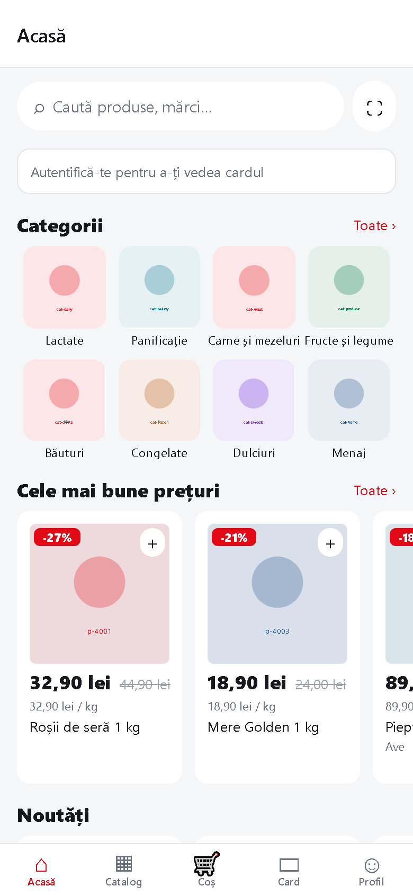
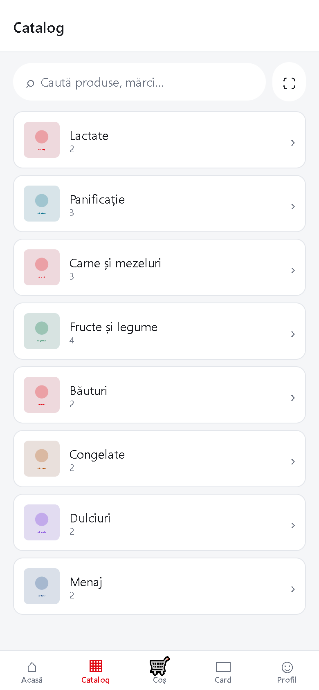
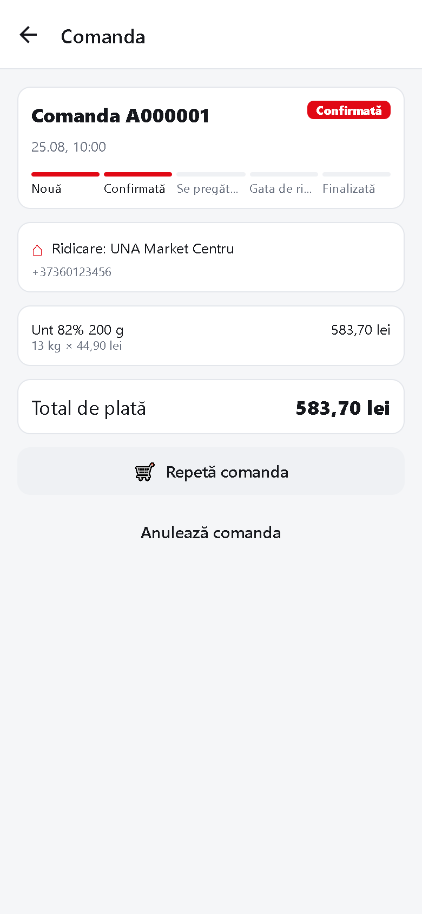
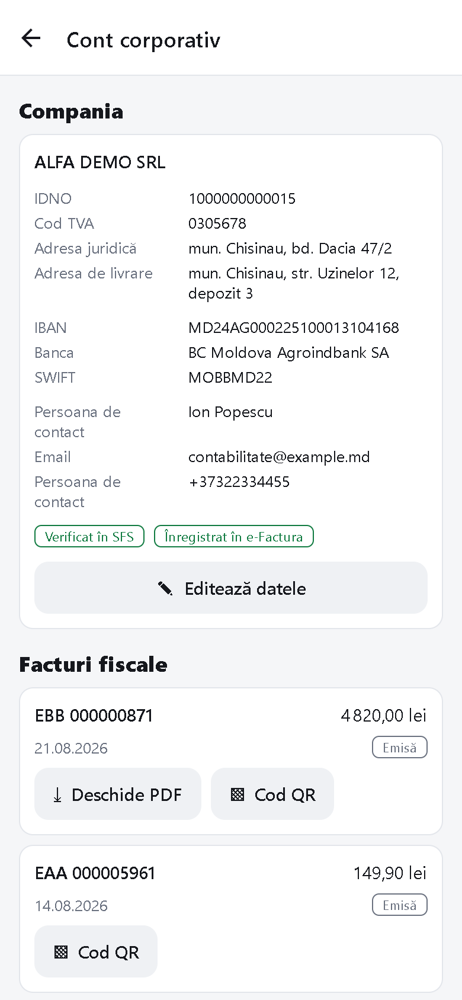
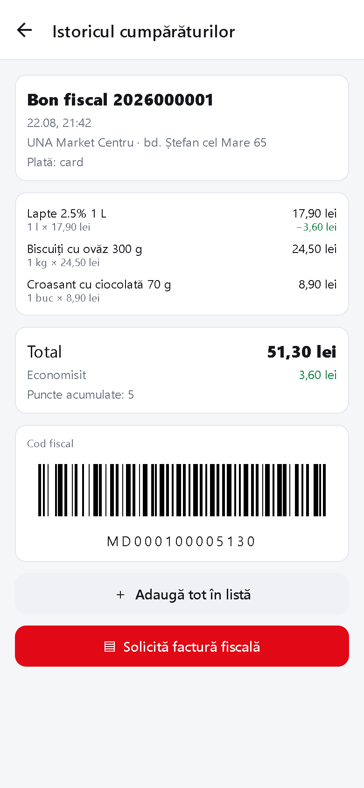
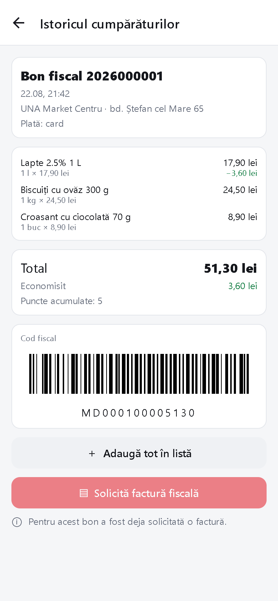
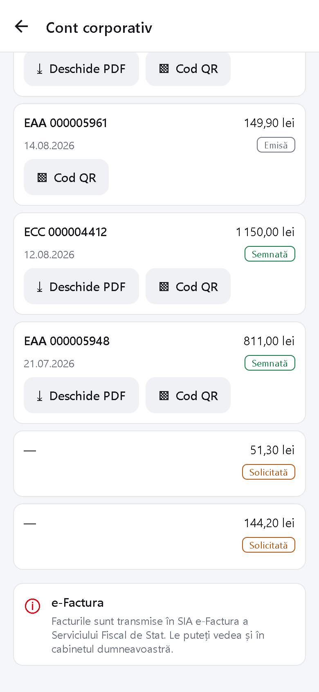
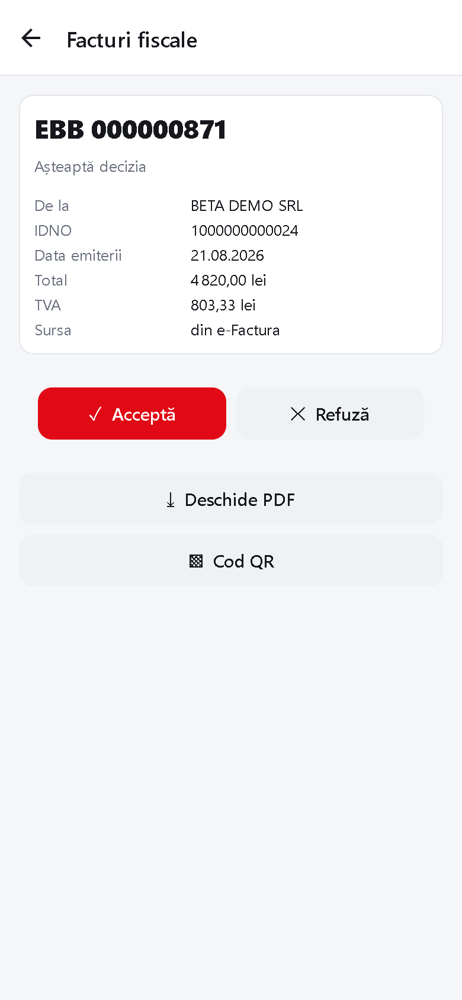

# Ghidul beneficiarului

[← cuprins](README.md)

Pentru proprietarul rețelei, directorul comercial sau managerul de proiect. Fără
detalii de cod: ce ați primit, ce puteți schimba, ce urmează.

---

## 1. Ce ați primit

**O aplicație mobilă cu marca rețelei**, pentru cumpărători și pentru firme,
într-o singură aplicație. **Un microserviciu** care emite și primește facturi
fiscale prin SIA „e-Factura”.

| Pentru cine | Ce face | Ce câștigă rețeaua |
|---|---|---|
| **Cumpărător** | caută produse, scanează coduri de bare, comandă cu ridicare sau livrare, folosește cardul de fidelitate și cupoanele, își vede bonurile | vânzări online, date despre cumpărători, canal direct fără intermediari |
| **Firmă cumpărătoare** | cere factura fiscală de pe bon, cu un singur buton | contabilitatea nu mai primește apeluri telefonice pentru facturi |
| **Contabil** | vede într-un singur loc facturile de la toți furnizorii, le acceptă sau le refuză | motiv pentru care firmele rămân în aplicație |
| **Rețeaua** | emite facturi fiscale automat, cu evidență și reluare la erori | mai puțină muncă manuală, mai puține greșeli |

### Aplicația merge și fără internet

Toate datele sunt păstrate pe telefon. Catalogul, bonurile, cupoanele și
facturile se deschid fără conexiune. Ce face utilizatorul offline (comandă,
modificare de profil, cerere de factură) așteaptă într-o coadă și pleacă singur
când apare conexiunea.

---

## 2. Funcțiile, pe module

| Modul | Conținut | Pornit implicit |
|---|---|---|
| Catalog și căutare | 2 niveluri de categorii, sortare, căutare în română, rusă și engleză, scaner de coduri de bare | da |
| Promoții | bannere, cataloage de promoții, produse la reducere | da |
| Coș și comenzi | comandă minimă, livrare gratuită de la un prag, intervale orare, ridicare sau livrare, repetarea și anularea comenzii | da |
| Fidelitate | card cu cod de bare, puncte, nivel | da |
| Cupoane | activare, aplicare în coș | da |
| Bonuri electronice | istoricul cumpărăturilor, cod fiscal, „adaugă tot în listă” | da |
| Lista de cumpărături | produse și poziții libere, bifare | da |
| Notificări push | teme: promoții, comenzi, personale | da, dar cere configurarea Firebase |
| Cont corporativ | datele companiei, cererea facturii de pe bon, lista facturilor | da |
| Portofel | facturi primite și emise, conectarea companiei la e-Factura, acceptare și refuz | da |
| Plăți | plata facturii din aplicație | **nu** — vezi secțiunea 6 |

Fiecare modul are un comutator. Modulul oprit dispare complet: fără meniu, fără
ecran, fără date pe telefon.

---

## 3. Ce puteți schimba fără o versiune nouă în magazine

Aspectul și comportamentul vin din fișiere de configurare, pe care serverul le
poate înlocui de la distanță.

| Vreți să… | Se schimbă prin |
|---|---|
| porniți sau opriți un modul | `features` în `app.config.json` |
| schimbați culorile mărcii | `theme.config.json` — de regulă 4 valori |
| rearanjați ecranul principal | `config/screens/home.json` |
| modificați comanda minimă, taxa de livrare, pragul de livrare gratuită, intervalele | `cart` în `app.config.json` |
| schimbați un text în orice limbă | `config/l10n/ro.json`, `ru.json`, `en.json` |
| schimbați termenul de solicitare a facturii (acum 30 de zile) | `corporate.requestWindowDays` |

Dacă serverul trimite o configurație greșită, aplicația o respinge și rămâne pe
cea anterioară. Un telefon nu poate fi „stricat” de la distanță.

**Cer o versiune nouă:** un tip nou de ecran, pictograma și numele aplicației,
permisiunile telefonului.

---

## 4. Factura fiscală, de la bon la SFS

1. Firma își completează o singură dată datele: IDNO, cod TVA, adrese, IBAN.
2. Pe bon apasă **Solicită factură fiscală**. A doua apăsare nu creează o a doua
   factură.
3. Cererea ajunge la backend-ul UNA.md, apoi la microserviciul e-Factura.
4. Microserviciul verifică aritmetica, rezervă seria, construiește XML-ul,
   îl semnează (dacă semnarea e configurată) și îl trimite în SFS.
5. Starea revine în aplicație: *Solicitată → Emisă → Semnată → Livrată*, sau
   *Refuzată*.

**Siguranța contra dublurilor.** Fiecare pas este scris în baza de date înainte
de următorul. După o cădere, serviciul continuă de unde a rămas și nu retrimite
factura.

### Portofelul: facturile de la toți furnizorii

Directorul firmei creează în cabinetul e-Factura un utilizator API și îl
introduce în aplicație, după un acord explicit. Serverul citește facturile o dată
la 15 minute.

- Datele de acces sunt criptate pe server (AES-256-GCM) și **nu se păstrează pe
  telefon**.
- Retragerea accesului **șterge fizic** datele, nu doar le marchează.
- Fiecare acces în numele firmei intră într-un jurnal de audit.

---

## 5. Ce a fost verificat și ce nu

| Verificat | Cum |
|---|---|
| Regulile, baza de date, sincronizarea, autentificarea | 208 teste automate (mobil) |
| SOAP, semnarea, coada, primirea facturilor | 89 de teste automate (microserviciu) |
| Parcursul complet în română: 36 de ecrane, cu autentificare, comandă, cerere de factură | rulare reală în browser, cu capturi |
| Conținutul APK-urilor: permisiuni, semnătură, arhitecturi | analiză statică |

| **Neverificat** | De ce | Ce e necesar |
|---|---|---|
| Rularea APK-ului pe telefon | calculatorul de compilare nu poate porni un emulator | instalare pe un telefon Android |
| Trimiterea unei facturi în SFS real | fără acces la mediul de test | cerere la CTIF, tel. 022 822222 |
| Baza Oracle reală | testele folosesc o implementare în memorie | o bază de test la beneficiar |
| Versiunea iOS | necesită macOS | compilare pe Mac sau în cloud |

---

## 6. Ce mai lipsește până la lansare

### Blochează lansarea aplicației

| # | Ce | Cine |
|---|---|---|
| 1 | **Backend-ul UNA.md** după [contractul API](../../mobile/docs/api-contract.md). Adresa `api.una.md/retail/v1` nu răspunde încă, deci aplicația normală pornește fără date | echipa UNA.md |
| 2 | Cheie proprie de semnare Android; acum se folosește cheia de depanare, acceptată la instalare directă, dar nu în Google Play | beneficiar |
| 3 | Proiect Firebase pentru notificări | beneficiar |
| 4 | Pictogramă, ecran de pornire, fotografii de produse | beneficiar |
| 5 | Test pe telefoane reale | beneficiar + echipa |

### Blochează facturarea în producție

| # | Ce | Cine |
|---|---|---|
| 1 | Acces la mediul de test SFS | beneficiar, prin CTIF |
| 2 | Confirmarea formulei de semnare: ghidul CTIF nu spune exact ce octeți se semnează; presupunerea este izolată într-o singură funcție | echipa, după punctul 1 |
| 3 | Utilizator API și certificat `.p12` al companiei | directorul companiei |
| 4 | Adaptarea celor trei vederi Oracle la schema reală | administratorul bazei |

### Planificat, nerealizat

- **Plata facturii din aplicație** — modelul de date există, dar lucrul cu bani
  cere o analiză juridică (PSP, cerințele BNM). Comutatorul este oprit.
- **Semnătura cumpărătorului** — cere semnătura electronică a firmei; se
  semnează deocamdată în cabinetul e-Factura.
- **Căutarea companiei după IDNO** în registrul SFS din formular — microserviciul
  o oferă, formularul din aplicație încă nu o folosește.
- **Exportul pentru contabilitate** (XML + CSV) și jurnalul de audit în aplicație.

---

## 7. Cum vedeți aplicația chiar azi

Instalați **UNA Market Demo** pe un telefon Android. Datele sunt în aplicație, nu
trebuie server și nici internet. Se instalează lângă aplicația normală.

Autentificare: orice număr `+373…`, codul **1234**. Pașii de instalare:
[GHID-UTILIZATOR.md](GHID-UTILIZATOR.md#1-instalarea).

> În demo, datele și comenzile sunt fictive și nimic nu pleacă spre magazine sau
> spre SFS. Nu introduceți date de acces reale la e-Factura.

## 8. Scenariu de recepție

| # | Acțiune | Rezultat așteptat |
|---|---|---|
| 1 | Porniți UNA Market Demo în modul avion | catalogul se deschide |
| 2 | Autentificați-vă cu `060 123 456`, codul `1234` | numele „Ion Popescu” în profil |
| 3 | Adăugați produse sub 150 lei | butonul de comandă e inactiv, se afișează cât mai lipsește |
| 4 | Treceți de 150 lei și trimiteți comanda | comanda primește un număr de forma A000001 și starea „Confirmată” |
| 5 | Activați un cupon | eticheta „Activat” |
| 6 | Deschideți cel mai nou bon și solicitați factura | butonul devine inactiv, apare explicația |
| 7 | Profil → Cont corporativ | factura nouă apare cu starea „Solicitată” |
| 8 | Profil → Portofel → factura „Așteaptă decizia” → Acceptă | starea devine „Se trimite”; în demo rămâne așa, fiindcă nu există SFS care să răspundă |
| 9 | Schimbați limba în rusă și în engleză | toate textele se schimbă |
| 10 | Ieșiți din cont | bonurile, cardul și facturile dispar de pe telefon; lista de cumpărături rămâne |

*Pașii 6 și 7 depind de data telefonului: bonurile demonstrative sunt din
iulie–august 2026, iar termenul de solicitare este de 30 de zile. După expirare
butonul este inactiv, cu explicația „Termenul de solicitare a expirat”.*
