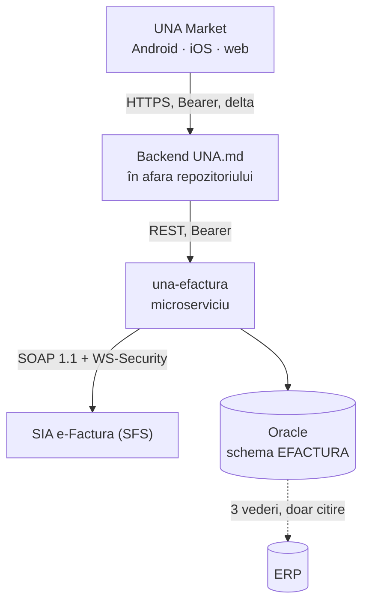

# Ghidul dezvoltatorului

[← cuprins](README.md)

Pentru programatori, testeri și administratori. Detaliile complete, în rusă, sunt
în [docs/INDEX.md](../INDEX.md); aici e drumul scurt.

---

## 1. Arhitectura



Trei granițe țin sistemul separabil:

| Graniță | Consecință |
|---|---|
| **Aplicația nu știe de SFS** | vede două câmpuri, `state` și `efactura_status`; un cod nou din SFS nu strică ecranul |
| **UNA.md nu semnează și nu vorbește SOAP** | certificatul și ordinea elementelor sunt grija unui singur serviciu |
| **Microserviciul nu scrie în ERP** | `DROP USER EFACTURA CASCADE` elimină complet integrarea |

## 2. Structura

```
mobile/
  config/             configurarea: module, temă, navigare, ecrane, entități, texte
  src/api             client HTTP: timeout, reluări, refresh la 401
  src/auth            autentificare, sesiune în keystore
  src/config          tipuri, îmbinare, validare
  src/db              SQLite: schemă din entități, migrări, depozite, _outbox
  src/sync            motorul de sincronizare push → pull
  src/domain          reguli pure: prețuri, coș, cupoane, companie, portofel
  src/demo            transportul versiunii demo
  src/ui              blocuri, ecrane, navigare
  tools/              server simulat, capturi, compilarea APK
  __tests__/          14 seturi, 208 teste
efactura-service/
  src/sfs             SOAP, 19 operații tipizate
  src/sign            XMLDSig: PKCS#12 sau PKI-Server
  src/queue           coada de ieșire și de intrare
  src/connections     conexiunile companiilor
  src/crypto          AES-256-GCM pentru datele de acces
  src/http            REST
  mock/               emulator SFS
  sql/  deploy/       migrări; systemd, Windows, Docker, OCI
docs/                 documentația (ru), docs/ro (română)
```

## 3. Pornirea locală

Cerințe: **Node.js 22+**. Oracle, certificatul și accesul la SFS nu sunt necesare.

```bash
cd mobile
npm ci
npm run start:mock
```

În alt terminal:

```bash
cd mobile
EXPO_PUBLIC_API_BASE_URL=http://localhost:4000 npx expo start --web
```

PowerShell:

```powershell
$env:EXPO_PUBLIC_API_BASE_URL="http://localhost:4000"; npx expo start --web
```

Microserviciul, pe emulator:

```bash
cd efactura-service
npm ci
npm run start:mock-sfs
```

```bash
cd efactura-service
EFACT__ORACLE__CONNECTSTRING=memory \
EFACT__SFS__ENDPOINT=http://127.0.0.1:4010/Service.svc \
EFACT__SFS__USERNAME=supplier EFACT__SFS__PASSWORD=supplier \
npm run dev
```

| Port | Serviciu |
|---|---|
| 4000 | API-ul UNA.md simulat |
| 4010 | SFS simulat (SOAP) |
| 8081 | Expo |
| 8090 | microserviciul e-Factura |

Autentificare demo: orice număr corect, codul `1234`.

> Metro nu vede întotdeauna fișierele noi și modificările din `config/*.json`.
> Dacă ecranul e vechi: `npx expo start --web --clear`.

## 4. Verificările

```bash
cd mobile && npm run check
```

```bash
cd efactura-service && npm run check
```

Fiecare rulează tipurile, validarea configurării și testele: **208** în mobil,
**89** în microserviciu. Niciun test nu iese în internet. CI rulează pe pull
request pentru `mobile/`; microserviciul **nu are încă** un flux CI.

Ce merită știut despre teste:

- `demo.test.ts` pornește aplicația reală pe serverul simulat încorporat și
  verifică să nu existe **niciun apel de rețea**;
- `corporate.test.ts` verifică să existe o rută pentru fiecare ecran la care
  trimite configurarea;
- `sign.test.ts` verifică criptografic o semnătură RSA reală;
- `soap.test.ts` fixează ordinea elementelor DataContract, pe care SFS o impune.

## 5. Configurarea

Ordinea priorității: `config/*.json` din aplicație → ultima configurare acceptată
de la server → `GET /app-config`. Obiectele se îmbină, **listele se înlocuiesc
integral**. O configurare care nu trece validarea se ignoră.

Un ecran este o listă de blocuri:

```json
{
  "id": "home-deals",
  "type": "product_carousel",
  "titleKey": "home.deals",
  "visibleIf": { "feature": "promoFlyers" },
  "props": {
    "source": {
      "entity": "products",
      "where": [{ "field": "discount_percent", "op": ">", "value": 0 }],
      "orderBy": [{ "field": "discount_percent", "dir": "desc" }],
      "limit": 20
    }
  }
}
```

| Vreau să adaug | Unde |
|---|---|
| un bloc | componenta în `src/ui/blocks/`, numele în `blockTypes.ts`, înregistrarea în `index.tsx` |
| un ecran din blocuri | `config/screens/x.json`, importul în `src/config/defaults.ts`, ruta în `RootNavigator.tsx` |
| o entitate | `config/entities.config.json` și creșterea `schemaVersion` |
| un text | aceeași cheie în `ro.json`, `ru.json`, `en.json` |

Referința completă: [configuration.md](../../mobile/docs/configuration.md).

## 6. Date și sincronizare

Interfața citește **doar** din SQLite. Sincronizarea e un proces separat: întâi
trimite coada `_outbox`, apoi descarcă delta după `updated_since`. Ordinea
contează: altfel o modificare locală proaspătă ar fi suprascrisă.

| Entitate | Endpoint | Direcție | Mod |
|---|---|---|---|
| `categories`, `products` | `/catalog/*` | descărcare | delta |
| `banners`, `stores` | `/content/banners`, `/network/stores` | descărcare | integral |
| `promotions` | `/promo/flyers` | descărcare | delta |
| `loyalty_account` | `/loyalty/account` | descărcare, cu cont | integral |
| `profile`, `company`, `connections` | `/account/*` | ambele, cu cont | integral, REST |
| `receipts` | `/account/receipts` | descărcare, cu cont | delta |
| `fiscal_invoices` | `/account/invoices` | ambele, cu cont | delta, REST |
| `payments`, `orders` | `/account/*` | ambele, cu cont | delta, REST |
| `coupons`, `favorites` | `/account/*` | ambele, cu cont | delta, pachet |
| `shopping_list_items` | `/list/items` | ambele | delta, REST |
| `cart_items` | — | doar local | — |

Identificatorii se generează pe telefon, deci retrimiterea e idempotentă.
Conflictele: câștigă serverul. Contractul: [api-contract.md](../../mobile/docs/api-contract.md).

**Excepție:** conectarea unei companii (`POST /account/connections`) **nu** trece
prin coadă, fiindcă `_outbox` e pe disc și parola nu are voie acolo.

## 7. Serverul simulat și versiunea demo

`tools/mock-backend.cjs` este o funcție pură *cerere → răspuns*, fără API-uri Node.
Același cod rulează în două locuri:

```
tools/mock-server.mjs   ──┐
                          ├──▶ tools/mock-backend.cjs ◀── tools/fixtures/*.json
src/demo/demoBackend.ts ──┘
```

Astfel demo-ul nu se poate îndepărta de ceea ce verifică testele. Demo-ul se
activează la compilare: `EXPO_PUBLIC_DEMO=1` (transport) și `APP_VARIANT=demo`
(pachet și nume, în `app.config.js`).

Codul demo există și în aplicația normală, dar e inactiv.

## 8. Compilarea APK

| Componentă | Versiune |
|---|---|
| JDK | 17 |
| Android SDK | platforma 36, build-tools 36.0.0 |
| NDK | 27.1.12297006 |
| Expo / React Native | 57 / 0.86, arhitectura nouă, Hermes |

```powershell
powershell -ExecutionPolicy Bypass -File tools\build-apk.ps1 -Variant demo -OutDir F:\apk
```

`-Variant prod` pentru aplicația normală. Scriptul face `prebuild --clean`,
reface setările locale din `android/` (care se regenerează de fiecare dată),
rulează Gradle și copiază APK-ul cu versiunea și commitul în nume. Prima
compilare durează circa 20 de minute.

Alte calculatoare: setați `ANDROID_HOME` și `JAVA_HOME` sau treceți `-SdkDir` și
`-JavaHome`.

**Semnarea.** APK-ul e semnat cu cheia de depanare. Pentru Google Play e nevoie de
o cheie proprie, păstrată în afara repozitoriului.

**Permisiuni.** `RECORD_AUDIO` și `SYSTEM_ALERT_WINDOW` sunt blocate în `app.json`.

**Notificări.** `google-services.json` lipsește; fără el, înregistrarea
tokenului nu reușește, iar restul aplicației merge normal.

## 9. Microserviciul e-Factura

```
pending → reserved → built → [signed] → posted → confirmed
                                            └──→ canceled
orice pas, eroare definitivă ───────────────────→ failed
```

Pasul se scrie în bază **înainte** de următorul. Erorile definitive (document
invalid, SOAP Fault, `Status = 3`, `1 - XML incorect`) opresc documentul imediat;
cele temporare (timeout, 429, 502, 503, lipsa seriilor) se reiau.

| Metodă | Rol |
|---|---|
| `GET /health`, `/ready`, `/stats` | stare; `/health` fără token |
| `POST /invoices` | primește documentul, validează sincron; `202` sau `422` cu detalii |
| `GET /invoices/{id}` și `/pdf`, `/qr`, `/xml` | stare și forme |
| `GET /taxpayers/{idno}` | registrul SFS |
| `POST /connections`, `GET`, `/verify`, `DELETE` | conexiunile companiilor |
| `GET /connections/{id}/audit` | jurnalul accesului |
| `GET /inbox`, `POST /inbox/{id}/accept`, `/reject` | facturile primite |
| `POST /tick`, `POST /inbox/tick` | rulează coada imediat |

Baza căii: `/efactura/v1`. Detalii: [API.md](../../efactura-service/docs/API.md).

### Instalarea

```bash
cp .env.example /etc/una-efactura/efactura.env
npm ci --omit=dev && npm run build
npm run validate-config
npm run migrate
```

| Mediu | Fișier |
|---|---|
| Ubuntu | `deploy/systemd/una-efactura.service` |
| Windows | `deploy/windows/install-service.ps1` (cere NSSM) |
| Docker | `deploy/Dockerfile`, `deploy/docker-compose.yml` |
| OCI | `deploy/oci/README.md` |

Variabilele sunt de forma `EFACT__SECTIUNE__CHEIE`. `validate-config` avertizează
asupra greșelilor de scriere. Primirea facturilor e oprită implicit:
`EFACT__INBOX__ENABLED=true` și o cheie `EFACT__CRYPTO__KEY`.

Ghidul complet: [DEPLOY.md](../../efactura-service/docs/DEPLOY.md).

## 10. Securitate

| Secret | Unde stă |
|---|---|
| sesiunea cumpărătorului | keystore-ul telefonului |
| `apiToken`, parolele SFS și Oracle, parola certificatului, cheia AES | doar variabile de mediu sau Vault |
| fișierul `.p12` | disc, `chmod 400` |
| parolele API ale clienților | Oracle, AES-256-GCM; retragerea le șterge fizic |

Reguli: niciun secret în JSON sau în Git; corpurile SOAP nu se scriu în jurnal;
`http` e respins pentru orice adresă în afară de localhost.

## 11. Capturile pentru documentație

```bash
cd mobile
SHOTS_DIR=../docs/ro/img LANG_CODE=ro node tools/screenshots-docs.mjs
```

Necesită serverul simulat și Expo web pornite. `LANG_CODE` poate fi `ro`, `ru`
sau `en`; textele se iau din `config/l10n`. Ceasul e fixat la 25.08.2026, săptămâna
datelor demonstrative. Pentru alt browser: `CHROMIUM_PATH`. Dacă Expo rulează pe
alt port: `APP_URL`.

## 12. Limitări cunoscute

| Limitare | Detalii |
|---|---|
| Backend-ul UNA.md lipsește | `api.una.md/retail/v1` nu răspunde |
| Octeții semnați nu sunt confirmați | o singură funcție de schimbat: `hashInput()` din `src/sign/xmldsig.ts` |
| SFS real neverificat | accesul se cere la CTIF, 022 822222 |
| Contractul PKI-Server STISC e presupus | o singură funcție: `requestSignature()` |
| Formularul companiei nu caută după IDNO | `taxpayerLookupEndpoint` e configurat, dar nefolosit |
| `corporate.requireVerification` nu e aplicat în interfață | etichetele se afișează, dar nu blochează |
| Ecranul de plată lipsește | ascuns de `wallet.payments.enabled: false` |
| Lista din contul corporativ arată și facturile primite | portofelul le separă |
| Citirea din ERP prin vederi nu e conectată | calea de lucru e `POST /invoices` |
| Interfața nu are teste de componente | parcursă cu scriptul de capturi |
| APK-ul nu a rulat pe telefon | doar analiză statică |

Lista completă și ordinea lucrărilor: [ROADMAP.md](../ROADMAP.md).
