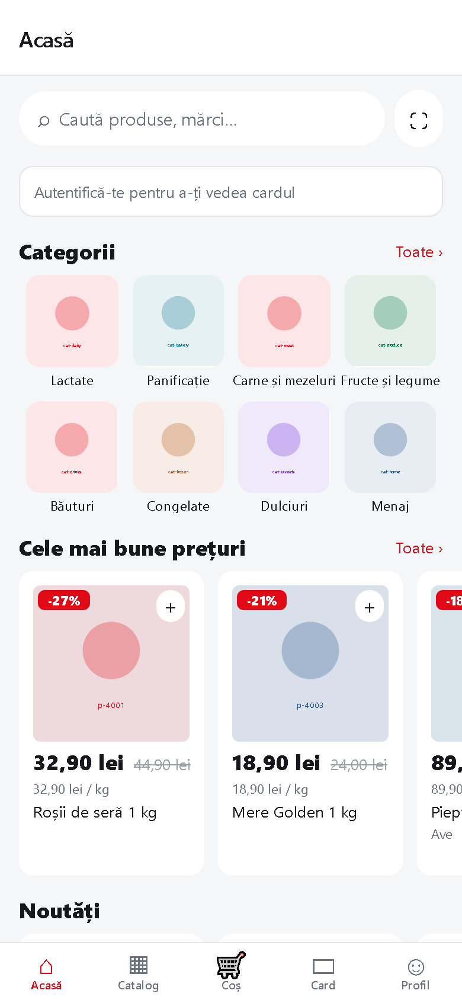
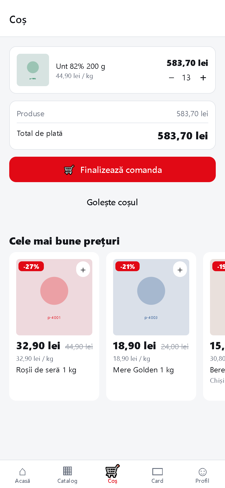
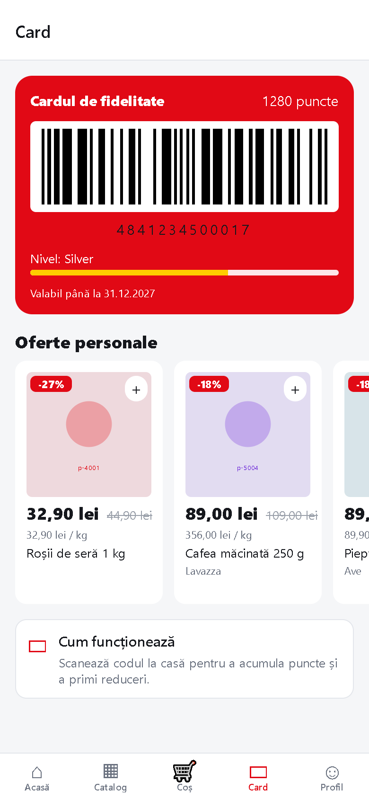
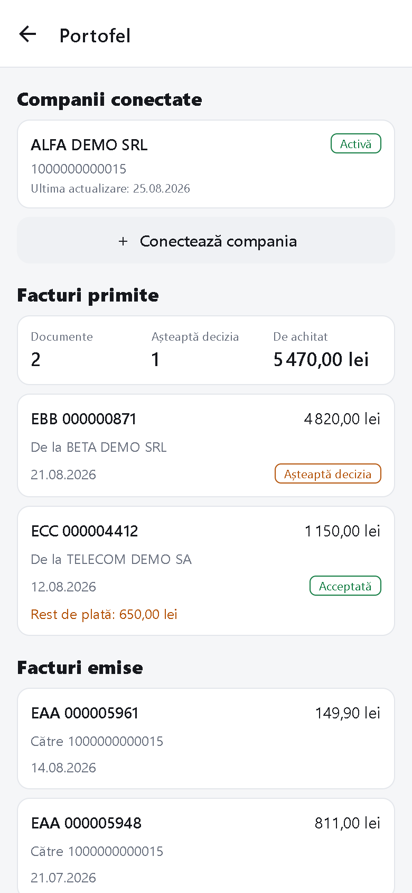

# UNA Market — documentația proiectului (RO)

Documentația în limba română, împărțită după cititor. Alegeți documentul după
întrebarea pe care o aveți; nu este nevoie să le citiți pe toate.

| Sunteți | Citiți | Veți afla |
|---|---|---|
| **Beneficiar / client** | [GHID-BENEFICIAR.md](GHID-BENEFICIAR.md) | ce ați primit, ce puteți schimba singuri, ce mai lipsește până la lansare și cine răspunde de fiecare pas |
| **Utilizator** (cumpărător sau contabil) | [GHID-UTILIZATOR.md](GHID-UTILIZATOR.md) | cum se instalează aplicația și cum se folosește fiecare ecran, cu imagini |
| **Dezvoltator / administrator** | [GHID-DEZVOLTATOR.md](GHID-DEZVOLTATOR.md) | cum e construit sistemul, cum se pornește local, cum se compilează APK-ul, cum se instalează microserviciul e-Factura |

## Proiectul pe scurt

Repozitoriul conține două sisteme independente:

| Sistem | Rol | Dosar |
|---|---|---|
| **UNA Market** | aplicația mobilă a rețelei de magazine (Android, iOS, web): catalog, coș, comenzi, card de fidelitate, cupoane, bonuri, cont corporativ, portofel de facturi fiscale | [`mobile/`](../../mobile/) |
| **una-efactura** | microserviciu autonom care vorbește cu SIA „e-Factura” a Serviciului Fiscal de Stat: trimite, semnează, urmărește și primește facturi fiscale | [`efactura-service/`](../../efactura-service/) |

<p>




</p>

## Starea la 25 noiembrie 2026

| Ce | Stare |
|---|---|
| Aplicația mobilă | funcțională; 208 teste automate trec |
| Microserviciul e-Factura | funcțional pe emulatorul SFS; 89 de teste automate trec |
| APK Android (normal și demo) | se compilează; verificate static, **nerulate încă pe un telefon real** |
| Backend-ul UNA.md | **în afara repozitoriului**; aplicația normală nu are date până nu există |
| SFS real | **neverificat**: nu există acces la mediul de test |

## Despre imagini

Capturile din [`img/`](img/) sunt ale aplicației reale, pornite în browser la
dimensiunea unui telefon, cu datele demonstrative din repozitoriu. Pozele
produselor sunt substitute, iar companiile, codurile IDNO și conturile bancare
sunt fictive. Se refac automat:

```bash
cd mobile
SHOTS_DIR=../docs/ro/img LANG_CODE=ro node tools/screenshots-docs.mjs
```

Documentația tehnică detaliată, în limba rusă: [docs/INDEX.md](../INDEX.md).
